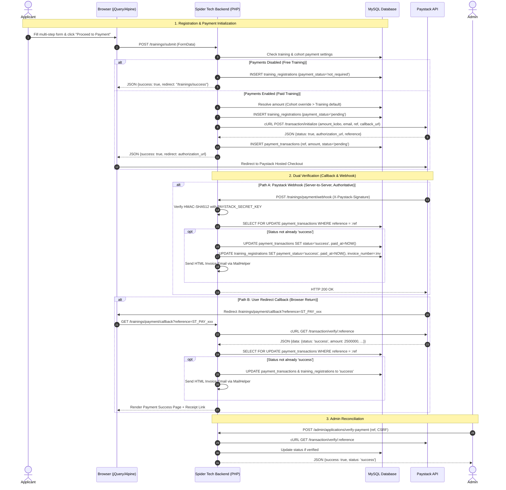

# Implementation Plan: Paystack Payment Integration for Trainings Feature

**Target Branch:** `feature/paystack-training-payments`  
**Status:** Implemented & Verified  
**Author:** Antigravity  
**Date:** November 2, 2026  

---

## 1. Discovery Findings

### 1.1 Architecture & Stack Summary
- **Backend Language & Runtime:** Vanilla PHP 8.3.x on Windows/cPanel (Apache). Zero backend frameworks (no Laravel, Symfony, or CodeIgniter).
- **Database Engine & Access:** MySQL / MariaDB (InnoDB). Database access uses raw **PDO with prepared statements** exclusively (`PDO::ATTR_ERRMODE => PDO::ERRMODE_EXCEPTION`, `PDO::ATTR_DEFAULT_FETCH_MODE => PDO::FETCH_ASSOC`). Database connection singleton is managed via `config/database.php` reading credentials from `config/db_config.php`.
- **Routing & Server Architecture:**
  - Front-controller pattern via `index.php`.
  - Apache `.htaccess` rewrites request URIs to `index.php?url=$1`.
  - Routes are configured in `$routes` inside `index.php` and dispatched by `utils/Router.php` (`Router::addRoute($path, $controller, $action)`).
- **Admin Authentication & Authorization:**
  - `AdminBaseController` extends `BaseController`.
  - Every controller extending `AdminBaseController` invokes `isAdminLoggedIn()` in its constructor, checking `isset($_SESSION['admin_id'])`.
  - Unauthenticated requests are redirected immediately to `admin/login`.
- **CSRF Protection:**
  - Utility class `utils/CSRF.php` provides `CSRF::generateToken()` and `CSRF::validateToken($token)`.
  - Stored in `$_SESSION['csrf_token']` with 1-hour expiration.
  - Currently utilized in auth, password reset, and forum controllers; standardizes drop-in validation for AJAX POST endpoints.
- **Existing Trainings, Cohorts & Application Tables:**
  - `trainings_tb`: Stores core training catalog (`id`, `training_name`, `training_description`, `training_details`, `training_image`, `registration_available` TINYINT(1), `start_date`, `end_date`, `created_at`, etc.).
  - `training_cohorts`: Stores cohorts per training (`id`, `training_id`, `cohort_number`, `cohort_name`, `slug`, `start_date`, `end_date`, `registration_open`, `show_topbar_banner`, `custom_announcement`, `registration_deadline`, `capacity`, `status`, `created_at`, `updated_at`).
  - `training_registrations`: Stores applicant submissions (`id`, `program_id`, `cohort_id`, `registration_type`, `user_data` JSON, `created_at`).
  - `training_form_fields`: Defines dynamic application form fields configured per program (`field_name`, `field_label`, `field_type`, `field_order`, `field_section`, `field_width`, `is_required`, `options`).
- **Database Migration Convention:**
  - Plain SQL scripts and PHP CLI migration files located in `database/migrations/` (e.g. `production_migration_cohorts_partners.sql`, `create_training_cohorts_table.php`).
  - Executed via cPanel phpMyAdmin or CLI.
- **Admin Management UI:**
  - `views/admin/trainings.php`: Lists trainings, toggles `registration_available` via AJAX (`admin/trainings/toggle`).
  - `views/admin/cohorts.php`: Manages cohort lifecycles, capacities, deadline dates, and banners.
  - `views/admin/applications.php`: Renders applicants table with search, program/cohort filters, modal inspector, and CSV export.
- **Public Registration Flow:**
  - `views/trainings/index.php` and `views/trainings/detail.php`: Show training info and "Register" button.
  - `views/trainings/register.php`: Multi-step form powered by Alpine.js (`x-data="registrationHandler()"`) and jQuery AJAX submission to `trainings/submit`.
- **Email Mechanism:**
  - `utils/MailHelper.php` loads `PHPMailer\PHPMailer\PHPMailer` via `require_once ROOT_PATH . '/vendor/autoload.php'`.
  - Configured with SMTP constants defined in `config/config.php` (`MAIL_HOST`, `MAIL_USER`, `MAIL_PASS`, `MAIL_PORT`, `MAIL_ENCRYPTION`, `MAIL_FROM_ADDRESS`, `MAIL_FROM_NAME`).
  - Contains polished, brand-aligned responsive HTML email templates (e.g. `sendCohortRegistrationConfirmation`).
- **Dependencies & Vendor Directory:**
  - Composer is used strictly for autoloading and PHPMailer. `vendor/` is in `.gitignore`.
  - Frontend libraries: jQuery is loaded locally (`js/jquery.min.js`), Alpine.js is loaded via CDN (`unpkg.com/alpinejs@3.x.x` and `@alpinejs/collapse`).
  - No CSS preprocessor or JS bundler exists; vanilla CSS files live under `css/`.
- **Environment Handling:**
  - No `.env` parsing library exists. `config/config.php` holds constants and `config/db_config.php` holds database credentials.
  - `.gitignore` already ignores `.env` and `.env.*`.
  - An ultra-light, dependency-free `.env` reader (`utils/Env.php`) can easily be implemented.
- **Existing Tests:**
  - Playwright E2E tests exist in `tests/` (`package.json` with `@playwright/test`). No PHPUnit runner is configured.

---

## 2. Evaluation and Architectural Recommendations

### 2.1 Checkout Experience: Hosted Redirect vs. Paystack Inline Popup
| Evaluation Criteria | Paystack Inline Popup (`PaystackPop.setup`) | Paystack Hosted Redirect (`authorization_url`) |
| :--- | :--- | :--- |
| **Dependencies** | Requires loading third-party external JS (`https://js.paystack.co/v1/inline.js`) | Zero frontend external scripts; 100% native HTTP redirect |
| **Mobile UX** | Popup modals can get blocked by mobile browsers, suffer viewport scrolling bugs on iOS Safari, or glitch in in-app browsers (Instagram, LinkedIn) | Native browser navigation; mobile-optimized by Paystack, works seamlessly on all devices and webviews |
| **Security Surface** | Public key exposed in frontend DOM; initial amount & metadata passed via client JS | Public key and transaction initialization stay strictly on the server; client never touches payment configuration |
| **Tamper Resistance** | Requires careful post-popup verification to prevent forged client-side success callbacks | Client cannot spoof payment success; verification occurs strictly server-to-server via backend cURL callback and webhook |
| **Failure Recovery** | If user closes popup or browser tab crashes, state recovery relies on client event listeners | If user drops off, the transaction URL remains valid in Paystack's system, and the application record preserves the pending reference |

> **Recommendation:** **Paystack Hosted Redirect.**  
> *Reasoning:* It requires zero external JavaScript dependencies, eliminates client-side DOM tampering, avoids popup blocker issues on mobile devices, and standardizes both desktop and mobile user flows onto Paystack's hosted, secure checkout page.

---

### 2.2 Invoice & Receipt Format: HTML + Print vs. Server-Side PDF (Dompdf/TCPDF)
| Evaluation Criteria | Server-Side PDF (Dompdf / TCPDF) | HTML Email + Dedicated Web Receipt (`trainings/invoice?ref=...`) |
| :--- | :--- | :--- |
| **PHP Dependencies** | Introduces 5–15 MB of composer dependencies (`dompdf/dompdf`, font caches, libxml/mbstring extensions) | **Zero dependencies**. Uses existing PHPMailer for HTML email and vanilla PHP/HTML/CSS for printable invoice |
| **cPanel Compatibility** | Risk of memory limit spikes, missing GD/FreeType extensions, or temporary font cache write permission failures | 100% reliable across any cPanel/shared hosting environment with standard PHP |
| **User Experience** | Applicant must download and open a separate PDF attachment | Applicant views rich HTML invoice directly inside their email client, with a "Print / Save as PDF" button that triggers `window.print()` using CSS `@media print` |
| **Admin Access** | Requires generating and storing static PDF files on the filesystem or generating on-the-fly | Admin can view, print, and re-send the invoice directly from the admin dashboard with one click |

> **Recommendation:** **Responsive HTML Email + Standalone Printable Web Invoice View.**  
> *Reasoning:* Avoids heavy Composer PDF libraries that bloat the repo and fail on shared cPanel memory limits. Users can view the invoice immediately in their email, or click a button to view a pixel-perfect, printer-friendly invoice webpage (`@media print` formatted for clean 1-page PDF export via browser print).

---

### 2.3 Data Model Architecture: Direct Columns vs. Dedicated Companion Table
| Aspect | Applications Table (`training_registrations`) Only | Dedicated Companion Table (`payment_transactions`) + Denormalized Fields |
| :--- | :--- | :--- |
| **Attempt History** | Can only store 1 transaction attempt. If a user tries, cancels/fails, and retries, previous attempt metadata is overwritten | Preserves full audit trail of all attempts (initializations, abandonments, failures, success) linked to the application |
| **Reconciliation & Gateway Logs** | Bloats `training_registrations` with Paystack transaction IDs, IP addresses, payment channels (card, ussd, bank_transfer), and gateway responses | Keeps gateway audit logs in `payment_transactions`, keeping `training_registrations` clean and optimized for application filtering |
| **Query Performance** | Fast for single-table reads, but complex when auditing financial logs | Best of both worlds: `training_registrations` holds fast-filter summary columns (`payment_status`, `payment_reference`, `amount_paid`), while `payment_transactions` holds full transaction details |

> **Recommendation:** **Dedicated Companion Table (`payment_transactions`) + Denormalized Summary Columns on `training_registrations`.**  
> *Reasoning:* This maintains clean database normalization and financial auditability (storing every initialization reference, gateway payload, and channel), while allowing the Admin Applications table to filter by payment status directly without complex multi-table joins.

---

### 2.4 Environment Configuration: Custom `.env` Loader vs. Composer `vlucas/phpdotenv`
- The project is vanilla PHP with no existing framework or `.env` loader.
- Adding `vlucas/phpdotenv` requires Composer dependency updates and extra autoloading overhead.
- A custom, dependency-free class `utils/Env.php` (~40 lines) can parse `.env` files into `$_ENV` and `getenv()` at startup, supporting comments, quoted strings, and defaults.
- Combined with an Apache rule in `.htaccess` (`<FilesMatch "^\.env"> Require all denied </FilesMatch>`), the environment file is secure from web snooping.

> **Recommendation:** **Custom Dependency-Free `utils/Env.php` Loader.**

---

## 3. Architecture & Payment Flow



### 3.1 Step-by-Step Flow Description
1. **Submission & Gating Check:**
   - The applicant submits the form to `trainings/submit`.
   - The backend validates the inputs.
   - The backend checks `trainings_tb.payments_enabled`.
   - If disabled (`0`), the application is saved with `payment_status = 'not_required'`, normal confirmation email is dispatched, and success is returned.
   - If enabled (`1`), the backend calculates the required amount (checking `training_cohorts.payment_amount` first, falling back to `trainings_tb.payment_amount`). If amount is $\le 0$, an error is returned.
2. **Transaction Initialization:**
   - Unique reference generated: `STP_{program_id}_{cohort_id}_{timestamp}_{random_hex}` (e.g. `STP_8_1_1730538000_a1f9`).
   - The registration record is saved in `training_registrations` with `payment_status = 'pending'` and `payment_reference = :ref`.
   - Backend calls Paystack cURL endpoint: `POST https://api.paystack.co/transaction/initialize`.
   - Payload includes: `email`, `amount` (in kobo: `amount_in_naira * 100`), `reference`, `callback_url` (`BASE_URL . '/trainings/payment/callback'`), and `metadata` (application ID, program ID, cohort ID, applicant name).
   - A row is inserted into `payment_transactions` with `status = 'pending'`.
   - Server returns JSON: `{"success": true, "redirect_url": "https://checkout.paystack.com/..."}`.
   - The frontend Alpine handler executes `window.location.href = response.redirect_url`.
3. **Payment Completion & The Dual-Verification Engine:**
   - **Paystack Webhook (`trainings/payment/webhook`):**
     - Paystack sends a `POST` request with header `x-paystack-signature`.
     - Backend verifies signature using `hash_equals(hash_hmac('sha512', $rawBody, $secretKey), $_SERVER['HTTP_X_PAYSTACK_SIGNATURE'])`.
     - If event is `charge.success`, it verifies that the paid amount and currency match the DB record.
     - Performs atomic idempotency check: `UPDATE payment_transactions SET status = 'success', ... WHERE reference = :ref AND status != 'success'`.
     - If rows affected $> 0$, it updates `training_registrations`, generates invoice number `INV-YYYYMM-XXXX`, and dispatches the HTML receipt email via `MailHelper`.
     - Returns HTTP 200 immediately.
   - **Callback Route (`trainings/payment/callback`):**
     - User is redirected back with query parameter `?reference=...`.
     - Backend calls Paystack cURL `GET https://api.paystack.co/transaction/verify/{reference}`.
     - Checks if verification returned `status === 'success'` and matched expected amount.
     - Runs the same atomic status update and invoice generation if the webhook has not already processed it.
     - Renders a clean success view (`views/trainings/payment-success.php`) showing invoice summary and download/print options.
4. **Admin Manual Reconciliation:**
   - In `views/admin/applications.php`, if an application is `pending` or `failed`, the admin can click "Verify with Paystack".
   - The controller queries Paystack API, reconciles status, and triggers invoice email if newly verified.

---

## 4. Data Model Changes & Migration Strategy

### 4.1 Schema Modifications

#### 1. Modifications to `trainings_tb`
- `payments_enabled` (`TINYINT(1) NOT NULL DEFAULT 0`): Master toggle for payments on this training.
- `payment_amount` (`INT UNSIGNED NOT NULL DEFAULT 0`): Default training fee in **kobo** (e.g. ₦35,000 = `3500000`).

#### 2. Modifications to `training_cohorts`
- `payment_amount` (`INT UNSIGNED NULL DEFAULT NULL`): Optional cohort-specific fee override in **kobo**. If `NULL` or `0`, falls back to `trainings_tb.payment_amount`.

#### 3. Modifications to `training_registrations`
- `payment_status` (`ENUM('not_required', 'pending', 'success', 'failed', 'abandoned') NOT NULL DEFAULT 'not_required'`): Denormalized status for instant filtering.
- `payment_reference` (`VARCHAR(100) NULL UNIQUE`): Active Paystack reference.
- `amount_paid` (`INT UNSIGNED NOT NULL DEFAULT 0`): Amount paid in kobo.
- `currency` (`VARCHAR(10) NOT NULL DEFAULT 'NGN'`): Transaction currency.
- `paid_at` (`DATETIME NULL`): Timestamp when payment was verified.
- `invoice_number` (`VARCHAR(50) NULL UNIQUE`): Unique invoice/receipt identifier (`INV-YYYYMM-XXXX`).
- `invoice_sent_at` (`DATETIME NULL`): Timestamp when receipt email was delivered (send-once guard).

#### 4. New Companion Table: `payment_transactions`
Tracks complete transaction attempt history and raw gateway metadata:
- `id` (`BIGINT UNSIGNED AUTO_INCREMENT PRIMARY KEY`)
- `application_id` (`INT UNSIGNED NOT NULL`): Foreign key to `training_registrations(id)`.
- `program_id` (`INT NOT NULL`): Foreign key to `trainings_tb(id)`.
- `cohort_id` (`INT NULL`): Foreign key to `training_cohorts(id)`.
- `reference` (`VARCHAR(100) NOT NULL UNIQUE`): Internal unique reference passed to Paystack.
- `paystack_reference` (`VARCHAR(100) NULL`): Paystack's internal transaction ID/reference.
- `amount` (`INT UNSIGNED NOT NULL`): Amount in kobo.
- `currency` (`VARCHAR(10) NOT NULL DEFAULT 'NGN'`)
- `channel` (`VARCHAR(50) NULL`): Card, bank, ussd, qr, mobile_money.
- `status` (`ENUM('pending', 'success', 'failed', 'abandoned') NOT NULL DEFAULT 'pending'`)
- `gateway_response` (`VARCHAR(255) NULL`): e.g. "Successful", "Insufficient Funds".
- `customer_email` (`VARCHAR(255) NOT NULL`)
- `metadata` (`TEXT NULL`): JSON representation of metadata sent to Paystack.
- `paid_at` (`DATETIME NULL`)
- `created_at` (`DATETIME NOT NULL DEFAULT CURRENT_TIMESTAMP`)
- `updated_at` (`DATETIME NOT NULL DEFAULT CURRENT_TIMESTAMP ON UPDATE CURRENT_TIMESTAMP`)
- `INDEX (application_id)`, `INDEX (program_id)`, `INDEX (status)`, `INDEX (created_at)`

---

### 4.2 Raw Migration SQL File: `database/migrations/add_paystack_payments.sql`

```sql
-- ============================================================================
-- Migration: Add Paystack Payment Support for Trainings Feature
-- Date: 2026-11-02
-- Description: Adds payment configuration to trainings and cohorts, updates
--              registrations table with payment status, and creates the
--              payment_transactions companion table.
-- ============================================================================

-- 1. Update trainings_tb with payment configuration
ALTER TABLE `trainings_tb`
    ADD COLUMN `payments_enabled` TINYINT(1) NOT NULL DEFAULT 0 AFTER `registration_available`,
    ADD COLUMN `payment_amount` INT UNSIGNED NOT NULL DEFAULT 0 AFTER `payments_enabled`;

-- 2. Update training_cohorts with optional cohort payment override
ALTER TABLE `training_cohorts`
    ADD COLUMN `payment_amount` INT UNSIGNED NULL DEFAULT NULL AFTER `capacity`;

-- 3. Update training_registrations with payment & invoice columns
ALTER TABLE `training_registrations`
    ADD COLUMN `payment_status` ENUM('not_required', 'pending', 'success', 'failed', 'abandoned') NOT NULL DEFAULT 'not_required' AFTER `user_data`,
    ADD COLUMN `payment_reference` VARCHAR(100) NULL AFTER `payment_status`,
    ADD COLUMN `amount_paid` INT UNSIGNED NOT NULL DEFAULT 0 AFTER `payment_reference`,
    ADD COLUMN `currency` VARCHAR(10) NOT NULL DEFAULT 'NGN' AFTER `amount_paid`,
    ADD COLUMN `paid_at` DATETIME NULL AFTER `currency`,
    ADD COLUMN `invoice_number` VARCHAR(50) NULL AFTER `paid_at`,
    ADD COLUMN `invoice_sent_at` DATETIME NULL AFTER `invoice_number`,
    ADD UNIQUE KEY `uniq_payment_reference` (`payment_reference`),
    ADD UNIQUE KEY `uniq_invoice_number` (`invoice_number`),
    ADD INDEX `idx_payment_status` (`payment_status`);

-- 4. Create payment_transactions companion table
CREATE TABLE IF NOT EXISTS `payment_transactions` (
    `id` BIGINT UNSIGNED AUTO_INCREMENT PRIMARY KEY,
    `application_id` INT UNSIGNED NOT NULL,
    `program_id` INT NOT NULL,
    `cohort_id` INT NULL,
    `reference` VARCHAR(100) NOT NULL,
    `paystack_reference` VARCHAR(100) NULL,
    `amount` INT UNSIGNED NOT NULL COMMENT 'Amount in kobo',
    `currency` VARCHAR(10) NOT NULL DEFAULT 'NGN',
    `channel` VARCHAR(50) NULL,
    `status` ENUM('pending', 'success', 'failed', 'abandoned') NOT NULL DEFAULT 'pending',
    `gateway_response` VARCHAR(255) NULL,
    `customer_email` VARCHAR(255) NOT NULL,
    `metadata` TEXT NULL,
    `paid_at` DATETIME NULL,
    `created_at` DATETIME NOT NULL DEFAULT CURRENT_TIMESTAMP,
    `updated_at` DATETIME NOT NULL DEFAULT CURRENT_TIMESTAMP ON UPDATE CURRENT_TIMESTAMP,
    UNIQUE KEY `uniq_tx_reference` (`reference`),
    INDEX `idx_tx_application_id` (`application_id`),
    INDEX `idx_tx_program_cohort` (`program_id`, `cohort_id`),
    INDEX `idx_tx_status` (`status`),
    INDEX `idx_tx_created_at` (`created_at`)
) ENGINE=InnoDB DEFAULT CHARSET=utf8mb4 COLLATE=utf8mb4_unicode_ci;

-- 5. Backfill existing applications as 'not_required' (safe idempotency)
UPDATE `training_registrations` 
SET `payment_status` = 'not_required' 
WHERE `payment_status` IS NULL OR `payment_status` = '';
```

### 4.3 Rollback SQL File: `database/migrations/add_paystack_payments_down.sql`

```sql
-- ============================================================================
-- Rollback: Remove Paystack Payment Support
-- ============================================================================

DROP TABLE IF EXISTS `payment_transactions`;

ALTER TABLE `training_registrations`
    DROP INDEX `uniq_payment_reference`,
    DROP INDEX `uniq_invoice_number`,
    DROP INDEX `idx_payment_status`,
    DROP COLUMN `invoice_sent_at`,
    DROP COLUMN `invoice_number`,
    DROP COLUMN `paid_at`,
    DROP COLUMN `currency`,
    DROP COLUMN `amount_paid`,
    DROP COLUMN `payment_reference`,
    DROP COLUMN `payment_status`;

ALTER TABLE `training_cohorts`
    DROP COLUMN `payment_amount`;

ALTER TABLE `trainings_tb`
    DROP COLUMN `payment_amount`,
    DROP COLUMN `payments_enabled`;
```

---

## 5. Endpoint & Controller Design

All endpoints follow the project's existing routing model in `index.php` and extend either `BaseController` (public) or `AdminBaseController` (admin).

```
[Public Routes]
trainings/payment/init       -> TrainingController::initPayment       (POST)
trainings/payment/callback   -> TrainingController::paymentCallback   (GET)
trainings/payment/webhook    -> TrainingController::paymentWebhook    (POST)
trainings/invoice            -> TrainingController::viewInvoice       (GET)

[Admin Routes]
admin/trainings/toggle-payments     -> AdminController::toggleTrainingPayments (POST)
admin/trainings/set-payment-amount  -> AdminController::setTrainingPaymentAmount (POST)
admin/cohorts/set-payment-amount    -> AdminController::setCohortPaymentAmount (POST)
admin/applications/verify-payment   -> AdminController::verifyApplicationPayment (POST)
admin/applications/resend-invoice   -> AdminController::resendApplicationInvoice (POST)
```

### 5.1 Endpoint Specifications

#### `POST trainings/submit` (Updated Registration Submission)
- **Role:** Handles application submission and routes to free completion or Paystack checkout initialization.
- **CSRF:** Validated via `CSRF::validateToken($_POST['csrf_token'])`.
- **Payment Enabled Handling:**
  - Saves registration record with `payment_status = 'pending'`.
  - Calculates amount in kobo.
  - Calls `PaystackService::initializeTransaction(...)`.
  - Saves `payment_transactions` record.
  - Returns JSON: `{"success": true, "requires_payment": true, "redirect_url": "https://checkout.paystack.com/..."}`.

#### `GET trainings/payment/callback`
- **Role:** User return URL from Paystack hosted checkout.
- **Query Params:** `?reference=STP_8_1_...`
- **Processing:**
  - Validates `reference`.
  - Calls `PaystackService::verifyTransaction($reference)`.
  - If verified, atomically updates transaction and registration status to `success`.
  - Dispatches invoice email if not already sent.
  - Redirects or renders `views/trainings/payment-success.php` with receipt details and print button.

#### `POST trainings/payment/webhook`
- **Role:** Asynchronous server-to-server authoritative payment event notification from Paystack.
- **Security:**
  - Exempt from CSRF and session checks.
  - Validates `HTTP_X_PAYSTACK_SIGNATURE` against `hash_hmac('sha512', file_get_contents('php://input'), PAYSTACK_SECRET_KEY)` using `hash_equals()`.
  - Rejects with HTTP 400 if invalid signature.
- **Processing:**
  - Parses event JSON.
  - If `event === 'charge.success'`, verifies amount and currency.
  - Performs atomic conditional update on DB.
  - Sends receipt email.
  - Responds with HTTP 200 `{"status": "ok"}` within 2 seconds.

#### `GET trainings/invoice`
- **Role:** Standalone printable HTML invoice page.
- **Query Params:** `?ref=STP_...&token=...` (token is HMAC-SHA256 signature to prevent unauthorized enumeration).
- **View:** Clean, minimalist branded invoice view with `@media print` CSS and "Print / Download PDF" button.

#### `POST admin/trainings/toggle-payments`
- **Role:** Toggles `payments_enabled` boolean flag on a training.
- **Security:** Admin session required (`AdminBaseController`), CSRF token required.
- **Input:** `program_id` (int), `enabled` (0 or 1), `csrf_token`.
- **Response:** JSON `{"success": true, "payments_enabled": 1}`.

#### `POST admin/trainings/set-payment-amount`
- **Role:** Updates default payment amount on a training.
- **Security:** Admin session required, CSRF token required.
- **Input:** `program_id` (int), `amount_naira` (float/int), `csrf_token`.
- **Validation:** Amount $\ge 0$. Converted to integer kobo (`amount_kobo = round($amount_naira * 100)`).
- **Response:** JSON `{"success": true, "amount_kobo": 2500000, "formatted_amount": "₦25,000.00"}`.

#### `POST admin/cohorts/set-payment-amount`
- **Role:** Sets cohort-level override amount (or null to inherit training default).
- **Security:** Admin session required, CSRF token required.
- **Input:** `cohort_id` (int), `amount_naira` (nullable), `csrf_token`.
- **Response:** JSON `{"success": true}`.

#### `POST admin/applications/verify-payment`
- **Role:** Admin manually forces a re-verification of a pending/failed payment reference against Paystack API.
- **Security:** Admin session required, CSRF token required.
- **Input:** `application_id` (int), `csrf_token`.
- **Response:** JSON `{"success": true, "status": "success", "message": "Payment verified and receipt sent."}`.

---

## 6. UI / UX Design & Frontend Integration

### 6.1 Admin UI: Trainings Console (`views/admin/trainings.php`)
1. **Payments Master Toggle & Fee Column:**
   - In the training rows/cards, add an **"Enrollment Fee"** section.
   - Alpine.js component: `x-data="trainingPaymentManager({ id: <?= $t['id'] ?>, enabled: <?= $t['payments_enabled'] ?>, amount: <?= $t['payment_amount'] / 100 ?> })"`
   - Toggling the switch prompts or saves via AJAX to `admin/trainings/toggle-payments`.
   - If enabled, displays an inline editable fee badge (e.g. `₦35,000`) with a quick edit pencil modal to update `admin/trainings/set-payment-amount`.
   - Visual indicator: green pill for "Paid (₦XX,XXX)" and gray pill for "Free Registration".

### 6.2 Admin UI: Cohorts Modal & Manager (`views/admin/cohorts.php`)
- In the Cohort Add/Edit modal, add an optional field:
  - **"Cohort Fee Override (₦)"** with helper text: *"Leave empty or 0 to inherit default training fee (₦XX,XXX)"*.
  - Handled via `cohorts.js` AJAX and validated server-side.

### 6.3 Admin UI: Applications Register (`views/admin/applications.php`)
1. **KPI Stat Card:**
   - Add a 4th KPI card to the top stats grid: **"Revenue Collected"** (`₦X,XXX,XXX` total verified payments) alongside **"Paid Applications"** count.
2. **Table Badge Column:**
   - Add a `Payment Status` badge column:
     - `success` $\rightarrow$ Green badge `Paid (₦XX,XXX)` with link to view receipt.
     - `pending` $\rightarrow$ Orange badge `Pending Payment` with an inline "Verify" icon button.
     - `failed` $\rightarrow$ Red badge `Payment Failed` with "Re-check" button.
     - `not_required` $\rightarrow$ Gray badge `Free`.
3. **Filter Dropdown:**
   - Add a "Payment Status" filter select (`All`, `Paid`, `Pending Payment`, `Free`) that updates the table/CSV export.
4. **Application Detail Modal:**
   - Shows transaction reference, amount paid, payment channel (Card, USSD, Transfer), payment timestamp, and a button to **"Re-send Receipt Email"**.

### 6.4 Applicant Registration Portal (`views/trainings/register.php`)
1. **Dynamic Fee Summary in Sidebar / Step 4 Review:**
   - If payments are enabled, the final review step displays an itemized fee breakdown:
     - Training Name & Cohort Name
     - **Enrollment Fee:** `₦XX,XXX.00`
     - Secure payment badge: *"Secured by Paystack (Card, Bank Transfer, USSD, QR)"*
   - Submit button text updates from *"Submit Application"* $\rightarrow$ *"Proceed to Payment (₦XX,XXX.00)"*.
2. **Client-Side Alpine Handler Integration:**
   - On clicking submit, the AJAX request sends formData to `trainings/submit`.
   - If response contains `requires_payment: true` and `redirect_url`:
     - Displays a brief loading state: *"Redirecting to secure payment checkout..."*.
     - Redirects browser to `response.redirect_url`.

---

## 7. Invoice Generation & Email Delivery

### 7.1 Invoice Numbering Standard
- Format: `STP-INV-{YEAR}{MONTH}-{AUTO_INCREMENT_ID}` (e.g., `STP-INV-202611-0042`).
- Guaranteed unique via database unique index.

### 7.2 Receipt Email Template (`MailHelper::sendPaymentReceipt`)
- Reuses existing brand styling in `MailHelper.php` (Poppins font, `#110f0d` header with `#f48221` orange accent line, white card, structured table).
- Content elements:
  - Header: Spider Tech official logo.
  - Greeting: Personalized to applicant name.
  - Payment Confirmation Banner: "Payment Successful & Admission Confirmed".
  - Details Table:
    - **Invoice Number:** `STP-INV-202611-0042`
    - **Program:** Training name (e.g. *Full Stack Web Engineering*)
    - **Cohort:** Cohort name (e.g. *Cohort 1 - 2026*)
    - **Amount Paid:** `₦35,000.00`
    - **Payment Date:** `November 2, 2026 at 10:15 AM`
    - **Payment Channel:** Card (Mastercard / Visa / Verve)
    - **Transaction Reference:** `STP_8_1_...`
  - Action Buttons:
    - Primary CTA: **"View / Print Official Receipt"** (links to `BASE_URL . '/trainings/invoice?ref=' . $ref . '&token=' . $token`).
  - Next Steps: Brief instructions on onboarding, cohort commencement dates, and WhatsApp/community access.
  - Footer: Spider Tech physical address, contact email, and support phone.

### 7.3 Printable Web Invoice Route (`trainings/invoice`)
- Rendered using `views/trainings/invoice.php`.
- Includes full Spider Tech corporate information, Tax/Invoice metadata, paid watermark/stamp, and applicant details.
- Clean `@media print` stylesheet that hides navigation, buttons, and footers, formatting cleanly to standard A4 page size.

---

## 8. Environment Configuration & Security

### 8.1 Dedicated `.env` Variables
Add the following payment variables to `.env`:
```ini
# ==============================================================================
# Paystack Payment Gateway Configuration
# ==============================================================================
PAYSTACK_PUBLIC_KEY=pk_test_xxxxxxxxxxxxxxxxxxxxxxxxxxxxxxxxxxxxxxxx
PAYSTACK_SECRET_KEY=sk_test_xxxxxxxxxxxxxxxxxxxxxxxxxxxxxxxxxxxxxxxx
PAYSTACK_PAYMENT_URL=https://api.paystack.co
PAYSTACK_CURRENCY=NGN
PAYSTACK_TIMEOUT_SECONDS=30
PAYSTACK_VERIFY_SSL=true

# Invoice Security Salt (Used to sign printable invoice access tokens)
INVOICE_HASH_SALT=spider_tech_invoice_secure_salt_change_in_production
```

### 8.2 Safe Environment Loader: `utils/Env.php`
- Standalone PHP class that reads `.env` once at application bootstrap:
```php
class Env {
    public static function load($path) {
        if (!file_exists($path)) return;
        $lines = file($path, FILE_IGNORE_NEW_LINES | FILE_SKIP_EMPTY_LINES);
        foreach ($lines as $line) {
            $line = trim($line);
            if ($line === '' || str_starts_with($line, '#')) continue;
            if (strpos($line, '=') !== false) {
                list($name, $value) = explode('=', $line, 2);
                $name = trim($name);
                $value = trim($value, " \t\n\r\0\x0B\"'");
                if (!array_key_exists($name, $_SERVER) && !array_key_exists($name, $_ENV)) {
                    putenv("{$name}={$value}");
                    $_ENV[$name] = $value;
                    $_SERVER[$name] = $value;
                }
            }
        }
    }
    public static function get($key, $default = null) {
        return $_ENV[$key] ?? getenv($key) ?: $default;
    }
}
```
- Integrated into `config/config.php` right after `session_start()`.

### 8.3 Web Access Protection in `.htaccess`
Ensure `.env` cannot be accessed via direct HTTP GET:
```apache
<FilesMatch "^\.env">
    Order allow,deny
    Deny from all
    Require all denied
</FilesMatch>
```

---

## 9. Security Checklist

| Check | Mitigation / Implementation Details |
| :--- | :--- |
| **Server-Side Price Authority** | Amount is **never** accepted from `$_POST`. The controller queries the database for `training_cohorts.payment_amount` and `trainings_tb.payment_amount`, computing the kobo integer on the server. |
| **Timing-Safe Webhook Signature** | Webhook signature is validated using `hash_equals(hash_hmac('sha512', $rawBody, $secretKey), $_SERVER['HTTP_X_PAYSTACK_SIGNATURE'])`. This prevents timing attacks. |
| **Secret Key Isolation** | `PAYSTACK_SECRET_KEY` is loaded strictly on the server and never injected into HTML, scripts, logs, or error messages. |
| **CSRF Protection on Admin & Forms** | All admin payment toggles, price updates, and public form submissions validate `CSRF::validateToken($_POST['csrf_token'])`. |
| **Webhook CSRF Exemption** | The route `trainings/payment/webhook` is explicitly declared as a server-to-server webhook and bypasses session/CSRF validation. |
| **TLS/SSL Verification** | cURL requests to `https://api.paystack.co` have `CURLOPT_SSL_VERIFYPEER => true` and `CURLOPT_SSL_VERIFYHOST => 2`. |
| **cURL Timeouts** | Explicit connection timeout (`CURLOPT_CONNECTTIMEOUT => 10`) and execution timeout (`CURLOPT_TIMEOUT => 30`) prevent worker thread hangs on network lag. |
| **XSS Prevention on Invoices** | All dynamic fields (names, training titles, cohort names, references) are escaped with `htmlspecialchars($var, ENT_QUOTES, 'UTF-8')`. |
| **Invoice Enumeration Guard** | Public invoice view requires a signed HMAC token `hash_hmac('sha256', $reference, $salt)` so visitors cannot guess other applicants' references. |

---

## 10. Edge-Case Handling & Robustness

### 10.1 Webhook vs. User Callback Race Condition
- **Problem:** When an applicant completes payment, Paystack simultaneously fires the webhook to `trainings/payment/webhook` and redirects the user's browser to `trainings/payment/callback`. If both attempt to update the database and send emails simultaneously, duplicate receipt emails could be sent.
- **Solution:**
  1. Atomic conditional update:
     ```sql
     UPDATE payment_transactions 
     SET status = 'success', paid_at = NOW(), gateway_response = :resp 
     WHERE reference = :ref AND status != 'success';
     ```
  2. Inspect `$stmt->rowCount()`. Only the thread that actually transitioned the status from `pending` to `success` performs the secondary steps (updating `training_registrations`, generating invoice number, and firing `MailHelper::sendPaymentReceipt`).
  3. The `invoice_sent_at` column acts as an additional boolean check: if not null, email delivery is skipped.

### 10.2 Admin Edits Price While Applicant Is Checking Out
- **Problem:** Admin modifies the training fee while an applicant is on the Paystack checkout page.
- **Solution:** When Paystack completes, verification checks the amount paid against the `amount` column locked in `payment_transactions` at initialization time. If the applicant paid the initialized amount, the payment is honored.

### 10.3 Currency & Underpayment Tampering
- **Problem:** Malicious actor modifies Paystack checkout payload to pay in a weaker currency or lower amount.
- **Solution:** Verification callback checks:
  ```php
  if ($paystackData['currency'] !== 'NGN' || (int)$paystackData['amount'] !== (int)$expectedAmountKobo) {
      // Mark as failed/flagged for review; do not grant success
  }
  ```

### 10.4 Applicant Closes Browser Tab (Abandoned Payment)
- **Problem:** Applicant closes tab on Paystack without paying.
- **Solution:** Application remains in `pending` status. Admin sees `Pending Payment`. The applicant or admin can trigger re-payment or cleanup.

### 10.5 Timezone Normalization
- All date calculations and SQL `NOW()` queries run under consistent UTC or Africa/Lagos timezone set via `date_default_timezone_set('Africa/Lagos')` in `config/config.php`.

---

## 11. Testing & Verification Strategy

### 11.1 Test Matrix
1. **Free Training Flow:**
   - Training with `payments_enabled = 0`.
   - Submit registration $\rightarrow$ Verify application saved with `payment_status = 'not_required'`.
   - Verify regular admission email received.
2. **Paid Training Flow (Happy Path):**
   - Training with `payments_enabled = 1`, fee `₦30,000`.
   - Submit registration $\rightarrow$ redirected to Paystack test checkout.
   - Use Paystack test card (`4084 0840 0000 4080`, PIN `1111`, OTP `12345`).
   - Callback returns to success page $\rightarrow$ receipt displayed.
   - Verify database has `status = 'success'`, `amount_paid = 3000000`, `invoice_number` populated.
   - Verify HTML invoice email received with correct details.
3. **Cohort Override Fee:**
   - Training default `₦30,000`, Cohort 1 override `₦25,000`.
   - Verify initialization charges exactly `₦25,000` (2,500,000 kobo).
4. **Webhook Simulation:**
   - Use test script / curl to simulate Paystack `charge.success` with HMAC signature.
   - Verify webhook marks application `success` and returns HTTP 200 within 500ms.
   - Verify callback arriving afterward does not duplicate invoice or email.
5. **Declined / Failed Card:**
   - Test card with failure OTP $\rightarrow$ transaction marked `failed`.
   - Admin UI displays `Payment Failed`.
6. **Admin Gating & Security:**
   - Attempt to call `trainings/payment/init` with payment disabled $\rightarrow$ rejected with HTTP 400/403.
   - Attempt to toggle payment status without admin session or CSRF token $\rightarrow$ rejected with 401/403.

---

## 12. Rollout & Deployment Plan

1. **Step 1: Database Migration:**
   - Run `database/migrations/add_paystack_payments.sql` in phpMyAdmin on production.
   - Safe migration: columns added with safe defaults (`payments_enabled = 0`, `payment_status = 'not_required'`). Zero downtime.
2. **Step 2: Environment Configuration:**
   - Add Paystack test keys (`pk_test_...`, `sk_test_...`) to `.env` on production/staging.
   - Confirm `.htaccess` blocks public access to `.env`.
3. **Step 3: Deploy Codebase:**
   - Merge `feature/paystack-training-payments` into `main`.
   - Deploy code changes to server.
4. **Step 4: Smoke Test with Paystack Test Keys:**
   - Enable payments on a test training.
   - Execute an end-to-end test payment with a test card.
   - Verify invoice email delivery and admin dashboard display.
5. **Step 5: Switch to Live Keys:**
   - Update `.env` with live Paystack production keys (`pk_live_...`, `sk_live_...`).
   - Configure Paystack Dashboard Webhook URL to: `https://www.spidertech.com.ng/trainings/payment/webhook`.

---

## 13. Ordered Task Breakdown & Effort Estimates

| # | Task Description | Files Touched / Created | Est. Time |
| :--- | :--- | :--- | :--- |
| **Phase 1** | **Environment & Migration** | | |
| 1.1 | Create `utils/Env.php` and load in `config/config.php` | `utils/Env.php`, `config/config.php` | 25m |
| 1.2 | Create `.env.example` with Paystack variables and add `.htaccess` deny rule | `.env.example`, `.htaccess` | 15m |
| 1.3 | Create SQL migration and rollback files | `database/migrations/add_paystack_payments.sql`, `..._down.sql` | 30m |
| **Phase 2** | **Backend Paystack Client & Models** | | |
| 2.1 | Create `utils/PaystackService.php` (Raw cURL initialization, verification, webhook signature validator) | `utils/PaystackService.php` | 45m |
| 2.2 | Update `models/TrainingModel.php` to fetch/save `payments_enabled` & `payment_amount` | `models/TrainingModel.php` | 30m |
| 2.3 | Update `models/CohortModel.php` to handle cohort fee override | `models/CohortModel.php` | 20m |
| 2.4 | Create `models/PaymentModel.php` to manage `payment_transactions` & status reconciliation | `models/PaymentModel.php` | 45m |
| **Phase 3** | **Controller Endpoints & Webhook** | | |
| 3.1 | Add payment initialization and callback handling to `controllers/TrainingController.php` | `controllers/TrainingController.php` | 60m |
| 3.2 | Add webhook endpoint with signature verification in `controllers/TrainingController.php` | `controllers/TrainingController.php` | 45m |
| 3.3 | Register new routes in `index.php` | `index.php` | 15m |
| **Phase 4** | **Admin Features & AJAX Endpoints** | | |
| 4.1 | Add admin AJAX endpoints for toggling payments and setting amounts in `controllers/AdminController.php` | `controllers/AdminController.php` | 40m |
| 4.2 | Update `views/admin/trainings.php` with payments toggle, fee badge, and Alpine.js handler | `views/admin/trainings.php` | 45m |
| 4.3 | Update `views/admin/cohorts.php` modal with cohort fee override input | `views/admin/cohorts.php` | 30m |
| 4.4 | Update `views/admin/applications.php` with payment status badges, filters, revenue KPI, and manual verify button | `views/admin/applications.php` | 60m |
| **Phase 5** | **Applicant Frontend & Invoice** | | |
| 5.1 | Update `views/trainings/register.php` with fee summary on review step & redirect logic | `views/trainings/register.php` | 45m |
| 5.2 | Implement `MailHelper::sendPaymentReceipt` in `utils/MailHelper.php` | `utils/MailHelper.php` | 40m |
| 5.3 | Create standalone printable invoice view `views/trainings/invoice.php` and success view `views/trainings/payment-success.php` | `views/trainings/invoice.php`, `views/trainings/payment-success.php` | 45m |
| **Phase 6** | **Verification & Testing** | | |
| 6.1 | Test happy path, failed card, cohort override, and webhook idempotency | Manual & cURL testing | 60m |

---

## 14. Open Questions & Assumptions for User Confirmation

1. **Currency Assumption:**
   - *Assumption:* All training fees are billed in Nigerian Naira (**NGN**).
   - *Confirmation:* Does Spider Tech plan to accept international payments in USD/GBP/GHS, or is NGN the sole currency?
2. **Registration Record Timing (Pre-Payment vs. Post-Payment):**
   - *Design Choice:* The application record is inserted into `training_registrations` with `payment_status = 'pending'` when the user clicks "Proceed to Payment", and then updated to `success` upon payment confirmation.
   - *Benefit:* Allows admins to track abandoned applications and follow up with applicants who started but did not finish checkout.
   - *Confirmation:* Does this align with your expectations, or should registrations only be saved after payment succeeds?
3. **Capacity Decrement Timing:**
   - *Assumption:* Cohort capacity is only decremented upon **successful** payment (or successful free registration), preventing unpaid pending checkouts from blocking cohort seats.
   - *Confirmation:* Please confirm if cohort seat allocation should be reserved during checkout or granted only upon verified payment.
4. **Default Payment State:**
   - *Design Choice:* All existing trainings and newly created trainings default to `payments_enabled = 0` (free). Payment gating is activated explicitly per training by the admin.
   - *Confirmation:* Please confirm this default.
