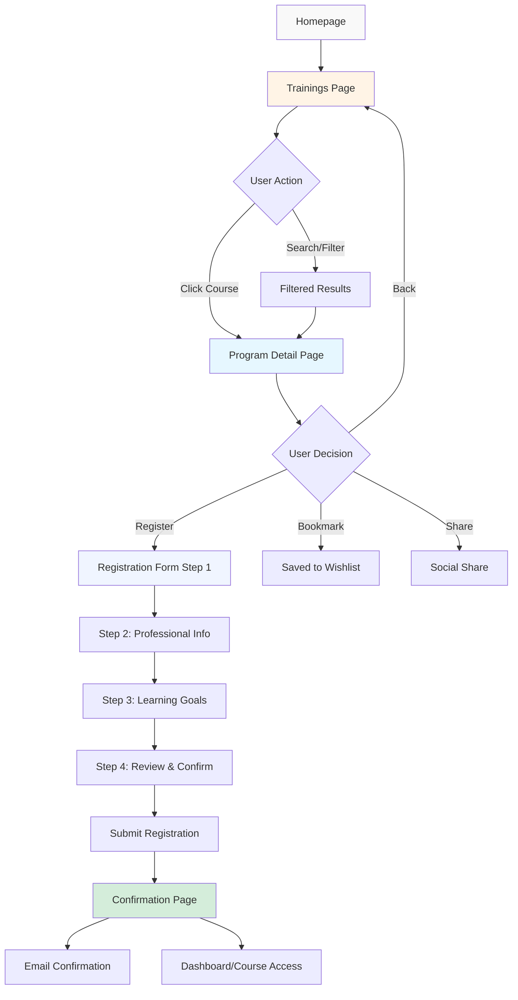
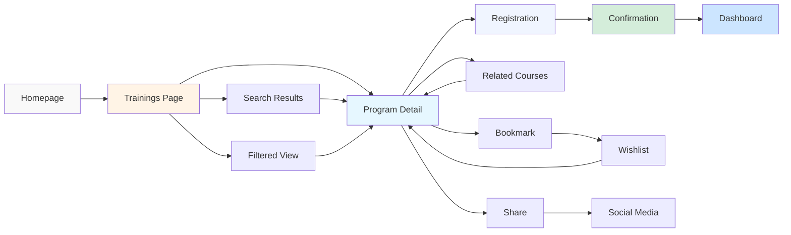
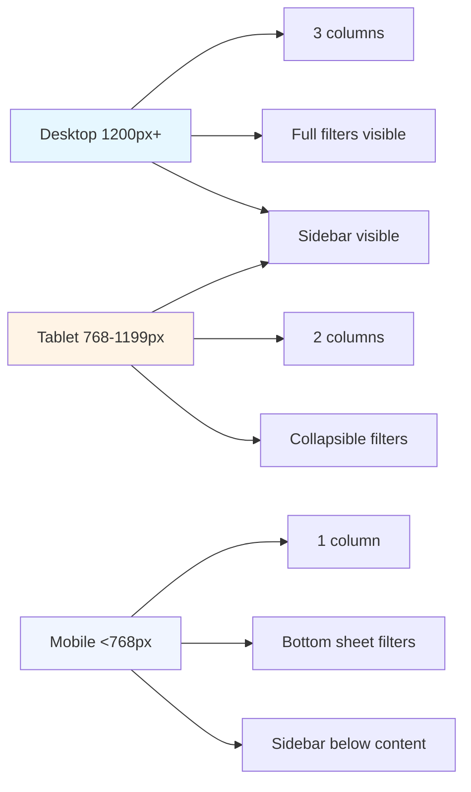
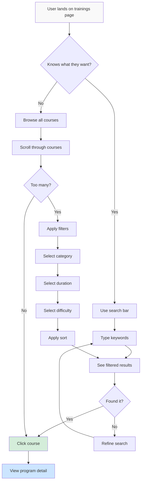
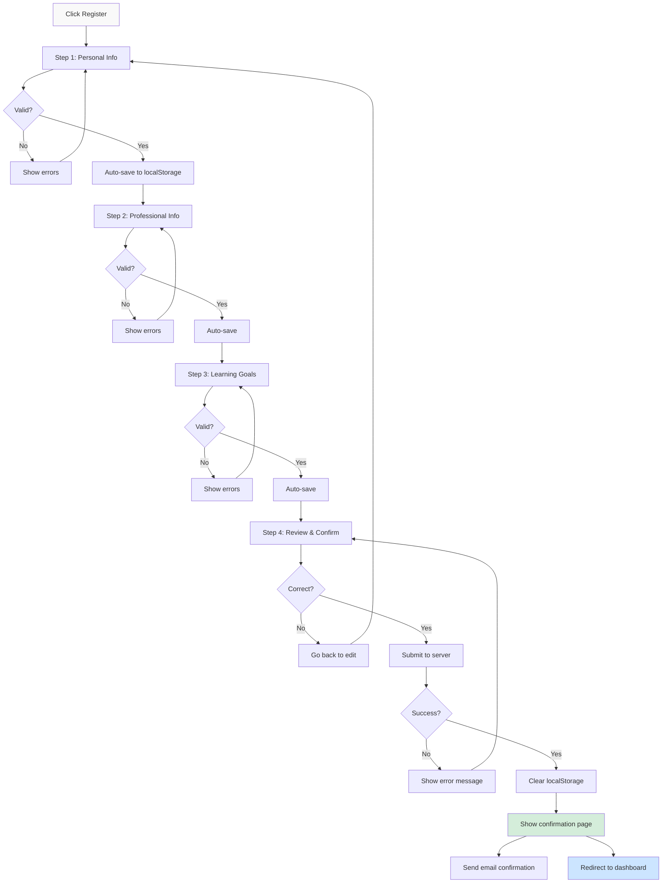

# Visual Mockups & User Flow Diagrams

This document contains visual representations of the proposed improvements using Mermaid diagrams and ASCII mockups.

---

## User Journey Flow



---

## Trainings Page Layout (Before vs After)

### Current Layout (Before)

```
┌─────────────────────────────────────────────────────────────┐
│                         HEADER                               │
├─────────────────────────────────────────────────────────────┤
│                                                              │
│                      HERO SECTION                            │
│                  "Our Training Programs"                     │
│                                                              │
├─────────────────────────────────────────────────────────────┤
│                                                              │
│  ┌──────────────┐  ┌──────────────┐  ┌──────────────┐     │
│  │  FEATURED    │  │   COURSE 2   │  │   COURSE 3   │     │
│  │   COURSE     │  │              │  │              │     │
│  │  (Gradient)  │  │   [Image]    │  │   [Image]    │     │
│  │              │  │   Title      │  │   Title      │     │
│  │   Title      │  │   Desc...    │  │   Desc...    │     │
│  │   Desc...    │  │              │  │              │     │
│  │              │  │  View Details│  │  View Details│     │
│  │ View Program │  └──────────────┘  └──────────────┘     │
│  └──────────────┘                                          │
│                                                              │
│  ❌ No filtering                                            │
│  ❌ No search                                               │
│  ❌ No metadata (duration, rating, students)                │
│  ❌ No sorting options                                      │
│                                                              │
└─────────────────────────────────────────────────────────────┘
```

### Improved Layout (After)

```
┌─────────────────────────────────────────────────────────────┐
│                         HEADER                               │
├─────────────────────────────────────────────────────────────┤
│  Home > Training Programs                    [BREADCRUMBS]  │
├─────────────────────────────────────────────────────────────┤
│                                                              │
│                      HERO SECTION                            │
│                  "Our Training Programs"                     │
│                                                              │
├─────────────────────────────────────────────────────────────┤
│  ┌──────────────────────────────────────────────────────┐  │
│  │ 🔍 Search courses...  │ Category ▼ │ Duration ▼ │    │  │
│  │                       │ Level ▼    │ Sort: Popular ▼│  │
│  └──────────────────────────────────────────────────────┘  │
├─────────────────────────────────────────────────────────────┤
│                                                              │
│  ┌──────────────┐  ┌──────────────┐  ┌──────────────┐     │
│  │  FEATURED    │  │   COURSE 2   │  │   COURSE 3   │     │
│  │   COURSE     │  │              │  │              │     │
│  │  (Gradient)  │  │   [Image]    │  │   [Image]    │     │
│  │   ⭐ NEW     │  │   Title      │  │   Title      │     │
│  │              │  │              │  │              │     │
│  │   Title      │  │ ⏱ 2h 14min   │  │ ⏱ 2h 49min   │     │
│  │   Desc...    │  │ 👥 41K students│ │ 👥 13K students│   │
│  │              │  │ ⭐ 4.9/5      │  │ ⭐ 4.9/5      │     │
│  │ 24 WEEKS     │  │              │  │              │     │
│  │ View Program │  │  View Details│  │  View Details│     │
│  └──────────────┘  │  🔖 Bookmark │  │  🔖 Bookmark │     │
│                    └──────────────┘  └──────────────┘     │
│                                                              │
│  ✅ Search & filters                                        │
│  ✅ Course metadata visible                                 │
│  ✅ Sorting options                                         │
│  ✅ Bookmark feature                                        │
│                                                              │
└─────────────────────────────────────────────────────────────┘
```

---

## Program Detail Page Layout (Before vs After)

### Current Layout (Before)

```
┌─────────────────────────────────────────────────────────────┐
│                         HEADER                               │
├─────────────────────────────────────────────────────────────┤
│                                                              │
│                      HERO SECTION                            │
│                   Course Title                               │
│                   Short description                          │
│                   [Register Button]                          │
│                                                              │
├─────────────────────────────────────────────────────────────┤
│  ┌────────────────────────┐  ┌──────────────────┐          │
│  │                        │  │  Apply now       │          │
│  │  About this program    │  │  [Register]      │          │
│  │                        │  │                  │          │
│  │  [HTML Content]        │  │  Need help?      │          │
│  │                        │  │  📧 Email        │          │
│  │                        │  │  📞 Phone        │          │
│  │                        │  │                  │          │
│  │                        │  └──────────────────┘          │
│  │                        │                                 │
│  └────────────────────────┘                                 │
│                                                              │
│  ❌ No course image                                         │
│  ❌ No metadata (duration, lessons, rating)                 │
│  ❌ No curriculum/syllabus                                  │
│  ❌ No reviews                                              │
│  ❌ No prerequisites                                        │
│  ❌ No related courses                                      │
│  ❌ Excessive whitespace (800px padding)                    │
│                                                              │
└─────────────────────────────────────────────────────────────┘
```

### Improved Layout (After)

```
┌─────────────────────────────────────────────────────────────┐
│                         HEADER                               │
├─────────────────────────────────────────────────────────────┤
│  Home > Training Programs > Soft Skills Course [BREADCRUMBS]│
├─────────────────────────────────────────────────────────────┤
│                                                              │
│                      HERO SECTION                            │
│                   Course Title                               │
│                   Short description                          │
│                   [Register Button] [🔖 Bookmark] [📤 Share]│
│                                                              │
├─────────────────────────────────────────────────────────────┤
│  ┌────────────────────────┐  ┌──────────────────┐          │
│  │                        │  │  Course Info     │          │
│  │  [COURSE IMAGE]        │  │  ⏱ 2h 14min     │          │
│  │                        │  │  📚 17 lessons   │          │
│  └────────────────────────┘  │  👥 41K students │          │
│                              │  ⭐ 4.9/5 (704)  │          │
│  ┌─────────────────────────────────────────────┐          │
│  │ ⏱ 2h 14min │ 📚 17 │ 👥 41K │ ⭐ 4.9 │ 🎓 Cert│          │
│  └─────────────────────────────────────────────┘          │
│                              │  🎓 Certificate  │          │
│  ┌────────────────────────┐  └──────────────────┘          │
│  │  About this program    │                                 │
│  │  [HTML Content]        │  ┌──────────────────┐          │
│  └────────────────────────┘  │  Apply now       │          │
│                              │  [Register]      │          │
│  ┌────────────────────────┐  └──────────────────┘          │
│  │  What you'll learn     │                                 │
│  │  ✓ Communication       │  ┌──────────────────┐          │
│  │  ✓ Teamwork            │  │  Need help?      │          │
│  │  ✓ Problem solving     │  │  📧 Email        │          │
│  │  ✓ Emotional intel.    │  │  📞 Phone        │          │
│  └────────────────────────┘  └──────────────────┘          │
│                                                              │
│  ┌────────────────────────┐                                 │
│  │  Course curriculum     │                                 │
│  │  ▼ Module 1: Personal Effectiveness (3 lessons, 25min) │
│  │     ▶ Intro to Personal Effectiveness (8min)           │
│  │     ▶ Time Management (10min)                          │
│  │     📝 Module 1 Quiz (7min)                            │
│  │  ▼ Module 2: Communication (4 lessons, 32min)         │
│  │  ...                                                    │
│  └────────────────────────┘                                 │
│                                                              │
│  ┌────────────────────────┐                                 │
│  │  Prerequisites         │                                 │
│  │  No prior experience   │                                 │
│  └────────────────────────┘                                 │
│                                                              │
│  ┌────────────────────────┐                                 │
│  │  Student reviews       │                                 │
│  │  4.9 ⭐⭐⭐⭐⭐ (704)    │                                 │
│  │  ████████░░ 5★ 85%     │                                 │
│  │  ███░░░░░░░ 4★ 12%     │                                 │
│  │                        │                                 │
│  │  John Doe ⭐⭐⭐⭐⭐     │                                 │
│  │  "Excellent course..." │                                 │
│  └────────────────────────┘                                 │
│                                                              │
│  ┌────────────────────────────────────────────────────────┐│
│  │  Students also viewed                                   ││
│  │  [Course 1]  [Course 2]  [Course 3]                    ││
│  └────────────────────────────────────────────────────────┘│
│                                                              │
│  ✅ Course image                                            │
│  ✅ Complete metadata                                       │
│  ✅ Curriculum visible                                      │
│  ✅ Reviews & ratings                                       │
│  ✅ Related courses                                         │
│  ✅ Proper spacing                                          │
│                                                              │
└─────────────────────────────────────────────────────────────┘
```

---

## Registration Form (Before vs After)

### Current Layout (Before)

```
┌─────────────────────────────────────────────────────────────┐
│                         HEADER                               │
├─────────────────────────────────────────────────────────────┤
│                                                              │
│                      HERO SECTION                            │
│              Register for [Course Name]                      │
│                                                              │
├─────────────────────────────────────────────────────────────┤
│  ┌──────────────────────────────────────────────────────┐  │
│  │  [Course Info Box]                                    │  │
│  │  Course Name                                          │  │
│  │  Description                                          │  │
│  └──────────────────────────────────────────────────────┘  │
│                                                              │
│  ┌──────────────────────────────────────────────────────┐  │
│  │  Personal Information                                 │  │
│  │  ─────────────────────                                │  │
│  │  First Name *        Last Name *                      │  │
│  │  Middle Name                                          │  │
│  │  Email *             Phone *                          │  │
│  │                                                        │  │
│  │  Demographics                                         │  │
│  │  ─────────────────────                                │  │
│  │  Age                 Gender                           │  │
│  │                                                        │  │
│  │  Professional Information                             │  │
│  │  ─────────────────────                                │  │
│  │  Occupation          Organization                     │  │
│  │  Experience Level                                     │  │
│  │                                                        │  │
│  │  Learning Goals & Requirements                        │  │
│  │  ─────────────────────                                │  │
│  │  Learning Goals [textarea]                            │  │
│  │  Special Requirements [textarea]                      │  │
│  │                                                        │  │
│  │  [Complete Registration]  [Back to Program]           │  │
│  └──────────────────────────────────────────────────────┘  │
│                                                              │
│  ❌ Long single-page form (overwhelming)                    │
│  ❌ No progress indicator                                   │
│  ❌ No auto-save                                            │
│  ❌ No field help text                                      │
│  ❌ Excessive whitespace (800px padding)                    │
│                                                              │
└─────────────────────────────────────────────────────────────┘
```

### Improved Layout (After) - Multi-Step Wizard

```
┌─────────────────────────────────────────────────────────────┐
│                         HEADER                               │
├─────────────────────────────────────────────────────────────┤
│  Home > Training > Course > Registration     [BREADCRUMBS]  │
├─────────────────────────────────────────────────────────────┤
│                                                              │
│                      HERO SECTION                            │
│              Register for [Course Name]                      │
│                                                              │
├─────────────────────────────────────────────────────────────┤
│  ┌──────────────────────────────────────────────────────┐  │
│  │  Progress: Step 1 of 4                                │  │
│  │  ●━━━━━━━━━○━━━━━━━━━○━━━━━━━━━○                     │  │
│  │  Personal   Professional  Goals    Confirm             │  │
│  └──────────────────────────────────────────────────────┘  │
│                                                              │
│  ┌──────────────────────────────────────────────────────┐  │
│  │  [Course Info Box]                                    │  │
│  │  Course Name • 2h 14min • 17 lessons • ⭐ 4.9        │  │
│  └──────────────────────────────────────────────────────┘  │
│                                                              │
│  ┌──────────────────────────────────────────────────────┐  │
│  │  Step 1: Personal Information                         │  │
│  │  ─────────────────────────────────                    │  │
│  │                                                        │  │
│  │  First Name *                                         │  │
│  │  [____________]  ℹ️ As it appears on certificate      │  │
│  │                                                        │  │
│  │  Last Name *                                          │  │
│  │  [____________]                                       │  │
│  │                                                        │  │
│  │  Email Address *                                      │  │
│  │  [____________]  ℹ️ We'll send confirmation here      │  │
│  │                                                        │  │
│  │  Phone Number *                                       │  │
│  │  [____________]  ℹ️ Format: +234 000 000 0000        │  │
│  │                                                        │  │
│  │  💾 Auto-saving...                                    │  │
│  │                                                        │  │
│  │                              [Next Step →]            │  │
│  └──────────────────────────────────────────────────────┘  │
│                                                              │
│  ✅ Multi-step wizard (less overwhelming)                   │
│  ✅ Progress indicator                                      │
│  ✅ Auto-save functionality                                 │
│  ✅ Field help text & tooltips                              │
│  ✅ Proper spacing                                          │
│                                                              │
└─────────────────────────────────────────────────────────────┘
```

---

## Component Hierarchy

```mermaid
graph TB
    A[Trainings Ecosystem] --> B[trainings.php]
    A --> C[program-detail.php]
    A --> D[register-program.php]
    
    B --> B1[Hero Section]
    B --> B2[Filters & Search]
    B --> B3[Course Grid]
    B --> B4[Mobile Nav]
    
    B2 --> B2a[Search Bar]
    B2 --> B2b[Category Filter]
    B2 --> B2c[Duration Filter]
    B2 --> B2d[Difficulty Filter]
    B2 --> B2e[Sort Dropdown]
    
    B3 --> B3a[Featured Card]
    B3 --> B3b[Regular Cards]
    
    B3b --> B3b1[Course Image]
    B3b --> B3b2[Metadata Icons]
    B3b --> B3b3[Title & Description]
    B3b --> B3b4[CTA Buttons]
    B3b --> B3b5[Bookmark Button]
    
    C --> C1[Hero Section]
    C --> C2[Breadcrumbs]
    C --> C3[Course Image]
    C --> C4[Stats Bar]
    C --> C5[Content Sections]
    C --> C6[Sidebar]
    
    C5 --> C5a[About]
    C5 --> C5b[What You'll Learn]
    C5 --> C5c[Curriculum]
    C5 --> C5d[Prerequisites]
    C5 --> C5e[Reviews]
    C5 --> C5f[Related Courses]
    
    C6 --> C6a[Course Info Card]
    C6 --> C6b[Apply Now Card]
    C6 --> C6c[Need Help Card]
    
    D --> D1[Hero Section]
    D --> D2[Progress Indicator]
    D --> D3[Form Steps]
    D --> D4[Navigation Buttons]
    
    D3 --> D3a[Step 1: Personal]
    D3 --> D3b[Step 2: Professional]
    D3 --> D3c[Step 3: Goals]
    D3 --> D3d[Step 4: Review]
    
    style A fill:#f48221,color:#fff
    style B fill:#fff4e6
    style C fill:#e6f7ff
    style D fill:#f0f5ff
```



---

## Information Architecture



---

## Mobile Responsive Breakpoints



---

## Filter & Search Flow



---

## Registration Wizard Flow



---

## Card Metadata Layout

```
┌────────────────────────────────────┐
│                                    │
│         [COURSE IMAGE]             │
│                                    │
├────────────────────────────────────┤
│  PROGRAM          SPIDER TECH      │
├────────────────────────────────────┤
│                                    │
│  Course Title Here                 │
│  (Max 2 lines with ellipsis)       │
│                                    │
├────────────────────────────────────┤
│  ⏱ 2h 14min  👥 41K  ⭐ 4.9/5     │
├────────────────────────────────────┤
│                                    │
│  Short description text that       │
│  provides overview of the course   │
│  content and value proposition.    │
│                                    │
├────────────────────────────────────┤
│  ⚡ Intensive    View Details →    │
│                 🔖 Bookmark        │
└────────────────────────────────────┘
```

---

## Stats Bar Layout (Program Detail)

```
┌──────────────────────────────────────────────────────────────┐
│  ⏱        📚        👥        ⭐        🎓                   │
│  Duration  Lessons  Students  Rating   Certificate           │
│  2h 14min  17       41,000+   4.9/5    Included             │
└──────────────────────────────────────────────────────────────┘
```

---

## Curriculum Accordion Structure

```
┌────────────────────────────────────────────────────────────┐
│  ▼ Module 1: Personal Effectiveness    3 lessons • 25min  │
│  ├─ ▶ Introduction to Personal Effectiveness      8min    │
│  ├─ ▶ Time Management Strategies                 10min    │
│  └─ 📝 Module 1 Quiz                              7min    │
│                                                            │
│  ▶ Module 2: Communication Skills       4 lessons • 32min │
│                                                            │
│  ▶ Module 3: Teamwork & Collaboration   3 lessons • 28min │
│                                                            │
│  ▶ Module 4: Emotional Intelligence     4 lessons • 35min │
│                                                            │
│  ▶ Module 5: Problem Solving            3 lessons • 29min │
└────────────────────────────────────────────────────────────┘
```

---

## Review Card Layout

```
┌────────────────────────────────────────────────────────────┐
│  John Doe                                    ⭐⭐⭐⭐⭐      │
│  Verified Student • 2 weeks ago                            │
│  ────────────────────────────────────────────────────────  │
│  Excellent course! The content is well-structured and      │
│  easy to follow. I've already applied many of the          │
│  concepts in my daily work. Highly recommended!            │
│  ────────────────────────────────────────────────────────  │
│  👍 Helpful (24)  💬 Reply                                 │
└────────────────────────────────────────────────────────────┘
```

---

## Mobile Bottom Navigation

```
┌────────────────────────────────────────────────────────────┐
│                                                            │
│  🏠        🔍         🔖        👤                         │
│  Home     Search    Saved     Profile                     │
│                                                            │
└────────────────────────────────────────────────────────────┘
```

---

## Color Palette

```
Primary Orange:   #f48221  ████████
Dark Orange:      #e6751c  ████████
Deep Orange:      #964900  ████████

Neutral Gray:     #f4f4f4  ████████
Light Gray:       #f9f9f9  ████████
Border Gray:      #e9ecef  ████████
Text Gray:        #555555  ████████
Dark Gray:        #111111  ████████

Success Green:    #d4edda  ████████
Error Red:        #f8d7da  ████████
Info Blue:        #e6f7ff  ████████
Warning Yellow:   #fff4e6  ████████
```

---

## Typography Scale

```
Hero Title:       4.5rem (72px)  - Plus Jakarta Sans 800
Section Title:    1.9rem (30px)  - Plus Jakarta Sans 700
Card Title:       1.25rem (20px) - Plus Jakarta Sans 700
Body Text:        1rem (16px)    - Work Sans 400
Small Text:       0.875rem (14px)- Work Sans 400
Tiny Text:        0.65rem (10px) - Work Sans 600
```

---

## Spacing System

```
xs:  0.25rem (4px)
sm:  0.5rem (8px)
md:  1rem (16px)
lg:  1.5rem (24px)
xl:  2rem (32px)
2xl: 3rem (48px)
3xl: 4rem (64px)
```

---

## Icon Usage Guide

```
⏱  schedule         - Duration
📚  menu_book        - Lessons/Modules
👥  groups           - Students enrolled
⭐  star             - Rating
🎓  workspace_premium- Certificate
⚡  bolt             - Intensity/Level
🔖  bookmark         - Save/Wishlist
📤  share            - Social sharing
✓   check_circle    - Completed/Included
▶   play_circle     - Video lesson
📝  quiz             - Quiz/Assessment
🔍  search           - Search functionality
📧  email            - Email contact
📞  phone            - Phone contact
```

---

## Accessibility Annotations

```html
<!-- Example: Course Card -->
<article class="training-card" 
         role="article" 
         aria-labelledby="course-title-1">
  
  
  
  <h3 id="course-title-1">Jobberman Soft Skills Course</h3>
  
  <div class="course-meta" aria-label="Course information">
    <span aria-label="Duration: 2 hours 14 minutes">
      <span class="material-symbols-outlined" aria-hidden="true">schedule</span>
      2h 14min
    </span>
    <span aria-label="41,000 students enrolled">
      <span class="material-symbols-outlined" aria-hidden="true">groups</span>
      41K students
    </span>
    <span aria-label="Rating: 4.9 out of 5 stars">
      <span class="material-symbols-outlined" aria-hidden="true">star</span>
      4.9/5
    </span>
  </div>
  
  <a href="program-detail.php?id=1" 
     class="register-btn"
     aria-label="View details for Jobberman Soft Skills Course">
    View Details
    <span class="material-symbols-outlined" aria-hidden="true">arrow_forward</span>
  </a>
</article>
```

---

## Performance Optimization Checklist

```
Images:
  ✓ Use WebP format with JPEG fallback
  ✓ Implement lazy loading (loading="lazy")
  ✓ Serve responsive images (srcset)
  ✓ Compress images (80% quality)
  ✓ Use CDN for external images

CSS:
  ✓ Minify CSS files
  ✓ Remove unused CSS
  ✓ Use CSS containment
  ✓ Defer non-critical CSS

JavaScript:
  ✓ Minify JS files
  ✓ Defer non-critical JS
  ✓ Use code splitting
  ✓ Implement service worker

Loading:
  ✓ Add skeleton loaders
  ✓ Show loading states
  ✓ Implement progressive enhancement
  ✓ Optimize critical rendering path
```

---

**Document Version**: 1.0  
**Created**: 2026-03-23  
**Status**: Ready for Implementation
