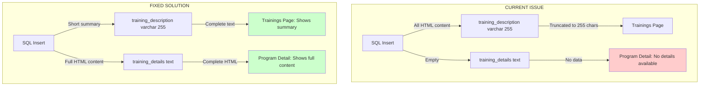
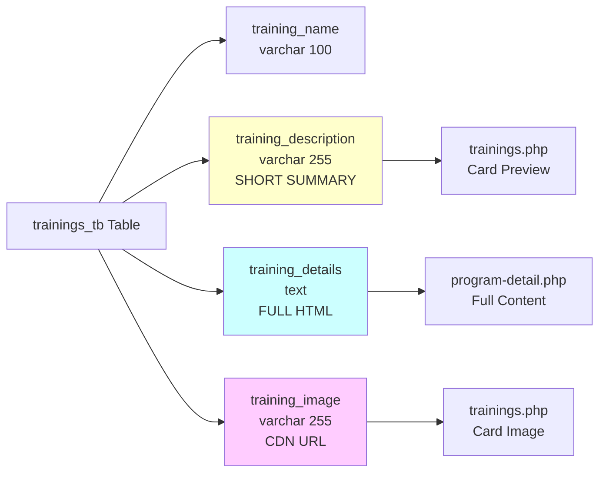
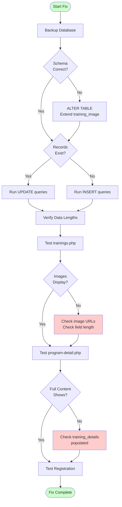

# Jobberman Trainings Fix - Implementation Plan

## Executive Summary

The trainings page currently fails to display program images and the program detail page shows "No program details available" due to incorrect database field usage. The root cause is that all HTML content is being inserted into `training_description` (varchar 255) instead of being properly split between `training_description` (short summary) and `training_details` (full content).

---

## Problem Analysis

### Current Database Schema

```sql
CREATE TABLE `trainings_tb` (
  `id` int NOT NULL AUTO_INCREMENT,
  `training_name` varchar(100) NOT NULL,
  `training_description` varchar(255) NOT NULL,  -- SHORT SUMMARY (max 255 chars)
  `training_details` text NOT NULL,              -- FULL HTML CONTENT
  `training_icon` varchar(64) NOT NULL,
  `training_image` varchar(64) NOT NULL,
  PRIMARY KEY (`id`)
)
```

### Issues Identified

1. **Field Misuse**: Current SQL inserts put full HTML content (2000+ chars) into `training_description` (max 255 chars)
2. **Empty Details**: `training_details` field is not populated, causing program detail page to show "No program details available"
3. **Image Display**: Cards don't show images because `training_image` field is populated but may be truncated or not properly referenced
4. **Data Truncation**: MySQL silently truncates `training_description` to 255 chars, losing most content

### Current Code Behavior

**trainings.php (Line 624):**
```php
" 
     alt="<?= htmlspecialchars(strip_tags($fetch_training['training_name'])); ?>">
```
✅ This correctly references `training_image` field

**trainings.php (Line 632):**
```php
<p class="card-desc"><?= nl2br(htmlspecialchars(strip_tags($fetch_training['training_description']))); ?></p>
```
✅ This correctly uses `training_description` for card preview

**program-detail.php (Line 41):**
```php
$program_details = isset($program['training_details']) 
    ? cleanProgramHTML($program['training_details']) 
    : '<p>No program details available.</p>';
```
❌ This expects `training_details` but field is empty in current data

---

## Solution Architecture

### Data Structure Design

#### 1. training_description (varchar 255)
**Purpose**: Short, plain-text summary for training cards
**Max Length**: 255 characters
**Format**: Plain text, no HTML
**Usage**: Card previews on trainings.php

**Example for Soft Skills Course:**
```
Master essential soft skills including communication, teamwork, emotional intelligence, and problem-solving. 17 lessons, self-paced, with certificate. 41,000+ students enrolled.
```

#### 2. training_details (text)
**Purpose**: Full HTML-formatted course information
**Max Length**: Unlimited (TEXT field)
**Format**: Rich HTML with styling
**Usage**: Full program detail page (program-detail.php)

**Example Structure:**
```html
<h4>Transform Your Professional Effectiveness</h4>
<p>Comprehensive description...</p>
<h5>Course Coverage:</h5>
<ul>
  <li>Module 1</li>
  <li>Module 2</li>
</ul>
<!-- Full detailed content -->
```

#### 3. training_image (varchar 64)
**Purpose**: URL to course thumbnail image
**Format**: Full CDN URL
**Current URLs**: 
- Soft Skills: `https://i.roamcdn.net/kazi/ng/base/c5b872f2d4093a5d8ac7fa4c63663ac6/-/advertiser-img-ng-jobs-prod/ng/form-builder/course_241/featured_image_0_1720086680.png`
- Entrepreneurship: `https://i.roamcdn.net/kazi/ng/base/b2a9be9b837bcd4a91ed30a95fb79bd5/-/advertiser-img-ng-jobs-prod/ng/form-builder/course_243/featured_image_0_1716468734.png`

---

## Implementation Strategy

### Phase 1: Create Corrected SQL Files

#### File 1: `database/update_jobberman_trainings.sql`
**Purpose**: UPDATE existing records if already inserted
**Action**: Split content properly between description and details fields

#### File 2: `database/insert_jobberman_trainings_corrected.sql`
**Purpose**: Fresh INSERT with proper field distribution
**Action**: Use for new installations or after deleting old records

### Phase 2: Update Documentation

#### File: `database/JOBBERMAN_COURSES_GUIDE.md`
**Updates Needed**:
- Clarify field purposes and character limits
- Add examples of proper data structure
- Update implementation instructions
- Add troubleshooting section

### Phase 3: Verification & Testing

#### Testing Checklist:
1. ✅ Verify images display on training cards
2. ✅ Verify short descriptions show on cards (not truncated HTML)
3. ✅ Verify program detail page shows full content
4. ✅ Verify HTML formatting renders correctly
5. ✅ Verify registration flow works end-to-end

---

## Detailed Course Data

### Course 1: Jobberman Soft Skills Course

#### Short Description (training_description - 255 chars max):
```
Master essential soft skills including communication, teamwork, emotional intelligence, and problem-solving. 17 engaging lessons, self-paced learning, with shareable certificate. Join 41,000+ students. Rating: 4.9/5
```
**Character Count**: 241 ✅

#### Full Details (training_details - HTML):
```html
<h4 style="color: #111111; font-weight: 700; margin-bottom: 15px;">Transform Your Professional Effectiveness</h4>
<p style="color: #555555; line-height: 1.8; margin-bottom: 15px;">Jobberman's Soft Skills Training is a comprehensive online program designed to empower professionals with the essential non-technical skills crucial for success in today's competitive job market.</p>

<h5 style="color: #f48221; font-weight: 600; margin-top: 20px; margin-bottom: 10px;">Course Coverage:</h5>
<ul style="color: #555555; line-height: 1.8; margin-left: 20px;">
  <li>Personal Effectiveness & Time Management</li>
  <li>Effective Communication Skills</li>
  <li>Teamwork & Collaboration Dynamics</li>
  <li>Emotional Intelligence Mastery</li>
  <li>Creativity & Innovation Stimulation</li>
  <li>Critical Thinking & Problem Solving</li>
</ul>

<h5 style="color: #f48221; font-weight: 600; margin-top: 20px; margin-bottom: 10px;">What You'll Get:</h5>
<ul style="color: #555555; line-height: 1.8; margin-left: 20px;">
  <li style="margin-bottom: 8px;"><strong>17 Engaging Lessons</strong> - Video lessons, interactive exercises, and thought-provoking quizzes</li>
  <li style="margin-bottom: 8px;"><strong>Self-Paced Learning</strong> - Study at your own pace with flexibility across web and mobile</li>
  <li style="margin-bottom: 8px;"><strong>Baseline & Final Assessments</strong> - Track your progress and measure your development</li>
  <li style="margin-bottom: 8px;"><strong>Shareable Certificate</strong> - Prestigious certificate upon completion to enhance your career prospects</li>
  <li><strong>Practical Relevance</strong> - Curriculum continuously updated to reflect latest industry trends</li>
</ul>

<h5 style="color: #f48221; font-weight: 600; margin-top: 20px; margin-bottom: 10px;">Course Highlights:</h5>
<p style="color: #555555; line-height: 1.8;">Whether you're a recent graduate, mid-career professional, or career changer, this program equips you with the skills to excel in your chosen field and stand out as a valuable asset to any organization. Our multifaceted approach combines theoretical knowledge with practical application, ensuring you gain real-world, actionable skills.</p>

<h5 style="color: #f48221; font-weight: 600; margin-top: 20px; margin-bottom: 10px;">Course Stats:</h5>
<ul style="color: #555555; line-height: 1.8; margin-left: 20px;">
  <li>Duration: 2 hours 14 minutes</li>
  <li>Students Enrolled: 41,000+</li>
  <li>Rating: 4.9/5 (704+ reviews)</li>
  <li>Format: 100% Online, Self-Paced</li>
  <li>Prerequisite: None - Open to everyone</li>
</ul>
```

#### Image URL:
```
https://i.roamcdn.net/kazi/ng/base/c5b872f2d4093a5d8ac7fa4c63663ac6/-/advertiser-img-ng-jobs-prod/ng/form-builder/course_241/featured_image_0_1720086680.png
```

---

### Course 2: Jobberman Entrepreneurship and Small Business

#### Short Description (training_description - 255 chars max):
```
Learn to launch and grow your business with 23 interactive lessons covering business planning, customer management, growth hacking, and financial basics. Self-paced, certificate included. Join 13,000+ entrepreneurs. Rating: 4.9/5
```
**Character Count**: 247 ✅

#### Full Details (training_details - HTML):
```html
<h4 style="color: #111111; font-weight: 700; margin-bottom: 15px;">Turn Your Business Ideas Into Reality</h4>
<p style="color: #555555; line-height: 1.8; margin-bottom: 15px;">A comprehensive program designed to empower aspiring entrepreneurs and small business owners with the essential knowledge and skills needed to succeed in the dynamic world of business. Whether launching a new venture or expanding an existing one, gain the insights and strategies to turn your ideas into reality.</p>

<h5 style="color: #f48221; font-weight: 600; margin-top: 20px; margin-bottom: 10px;">Core Modules Covered:</h5>
<ul style="color: #555555; line-height: 1.8; margin-left: 20px;">
  <li style="margin-bottom: 8px;"><strong>Business Preparation & Planning</strong> - Learn strategic planning essentials and lay the groundwork for success</li>
  <li style="margin-bottom: 8px;"><strong>The Business Model Canvas (BMC)</strong> - Create a clear and effective blueprint for your business model</li>
  <li style="margin-bottom: 8px;"><strong>Preparing a Simple Business Plan</strong> - Translate your vision into a practical, actionable business plan</li>
  <li style="margin-bottom: 8px;"><strong>Managing Customers</strong> - Discover strategies to build lasting relationships and drive growth</li>
  <li style="margin-bottom: 8px;"><strong>Growth Hacking Strategies</strong> - Unlock innovative and efficient strategies to accelerate business growth</li>
  <li style="margin-bottom: 8px;"><strong>Leveraging Social Media</strong> - Use social platforms to boost business presence and enhance profitability</li>
  <li><strong>Accounts for Non-Accountants</strong> - Demystify financial aspects of entrepreneurship regardless of your background</li>
</ul>

<h5 style="color: #f48221; font-weight: 600; margin-top: 20px; margin-bottom: 10px;">Learning Features:</h5>
<ul style="color: #555555; line-height: 1.8; margin-left: 20px;">
  <li style="margin-bottom: 8px;"><strong>Expert Instruction</strong> - Guided by experienced instructors with clarity and simplicity</li>
  <li style="margin-bottom: 8px;"><strong>23 Interactive Lessons</strong> - Engaging content that is directly applicable to your entrepreneurial endeavors</li>
  <li style="margin-bottom: 8px;"><strong>Self-Paced Learning</strong> - Access on web and mobile with complete flexibility</li>
  <li style="margin-bottom: 8px;"><strong>Final Assessment</strong> - Comprehensive evaluation of your entrepreneurial knowledge</li>
  <li><strong>Certificate of Achievement</strong> - Proudly showcase your mastery of entrepreneurship and small business principles</li>
</ul>

<h5 style="color: #f48221; font-weight: 600; margin-top: 20px; margin-bottom: 10px;">What You'll Master:</h5>
<p style="color: #555555; line-height: 1.8;">Upon completion, you will possess the knowledge and skills needed to navigate entrepreneurial challenges successfully. From market research and customer management to financial planning and growth strategies, this course provides a complete roadmap for building and scaling your business.</p>

<h5 style="color: #f48221; font-weight: 600; margin-top: 20px; margin-bottom: 10px;">Course Stats:</h5>
<ul style="color: #555555; line-height: 1.8; margin-left: 20px;">
  <li>Duration: 2 hours 49 minutes</li>
  <li>Students Enrolled: 13,000+</li>
  <li>Rating: 4.9/5 (395+ reviews)</li>
  <li>Format: 100% Online, Self-Paced</li>
  <li>Prerequisite: None - Open to aspiring and existing entrepreneurs</li>
</ul>
```

#### Image URL:
```
https://i.roamcdn.net/kazi/ng/base/b2a9be9b837bcd4a91ed30a95fb79bd5/-/advertiser-img-ng-jobs-prod/ng/form-builder/course_243/featured_image_0_1716468734.png
```

---

## SQL Implementation

### Option A: UPDATE Existing Records

Use this if you've already inserted the records using the old SQL:

```sql
-- Update Soft Skills Course
UPDATE `trainings_tb` 
SET 
  `training_description` = 'Master essential soft skills including communication, teamwork, emotional intelligence, and problem-solving. 17 engaging lessons, self-paced learning, with shareable certificate. Join 41,000+ students. Rating: 4.9/5',
  `training_details` = '[FULL HTML CONTENT HERE]',
  `training_image` = 'https://i.roamcdn.net/kazi/ng/base/c5b872f2d4093a5d8ac7fa4c63663ac6/-/advertiser-img-ng-jobs-prod/ng/form-builder/course_241/featured_image_0_1720086680.png'
WHERE `training_name` = 'Jobberman Soft Skills Course';

-- Update Entrepreneurship Course
UPDATE `trainings_tb` 
SET 
  `training_description` = 'Learn to launch and grow your business with 23 interactive lessons covering business planning, customer management, growth hacking, and financial basics. Self-paced, certificate included. Join 13,000+ entrepreneurs. Rating: 4.9/5',
  `training_details` = '[FULL HTML CONTENT HERE]',
  `training_image` = 'https://i.roamcdn.net/kazi/ng/base/b2a9be9b837bcd4a91ed30a95fb79bd5/-/advertiser-img-ng-jobs-prod/ng/form-builder/course_243/featured_image_0_1716468734.png'
WHERE `training_name` = 'Jobberman Entrepreneurship and Small Business';
```

### Option B: Fresh INSERT (Recommended)

Delete old records and insert with correct structure:

```sql
-- Delete old Jobberman records
DELETE FROM `trainings_tb` 
WHERE `training_name` LIKE 'Jobberman%';

-- Insert with proper field distribution
INSERT INTO `trainings_tb` 
  (`training_name`, `training_description`, `training_details`, `training_image`, `training_icon`) 
VALUES
  (
    'Jobberman Soft Skills Course',
    'Master essential soft skills including communication, teamwork, emotional intelligence, and problem-solving. 17 engaging lessons, self-paced learning, with shareable certificate. Join 41,000+ students. Rating: 4.9/5',
    '[FULL HTML CONTENT]',
    'https://i.roamcdn.net/kazi/ng/base/c5b872f2d4093a5d8ac7fa4c63663ac6/-/advertiser-img-ng-jobs-prod/ng/form-builder/course_241/featured_image_0_1720086680.png',
    'flat flaticon-soft-skills'
  );
```

---

## Code Review Findings

### ✅ trainings.php - Working Correctly

**Line 624**: Image display
```php
">
```
**Status**: ✅ Correct - Will work once `training_image` is properly populated

**Line 632**: Description display
```php
<p class="card-desc"><?= nl2br(htmlspecialchars(strip_tags($fetch_training['training_description']))); ?></p>
```
**Status**: ✅ Correct - Will work once `training_description` contains short text

### ✅ program-detail.php - Working Correctly

**Line 40-41**: Details display
```php
$program_description = isset($program['training_description']) ? cleanProgramHTML($program['training_description']) : '';
$program_details = isset($program['training_details']) ? cleanProgramHTML($program['training_details']) : '<p>No program details available.</p>';
```
**Status**: ✅ Correct - Will work once `training_details` is populated

**Line 295**: Hero subtitle uses description
```php
<p class="program-hero-subtitle"><?= $program_description; ?></p>
```
**Status**: ✅ Correct - Shows short description in hero

**Line 306**: Main content uses details
```php
<div><?= $program_details; ?></div>
```
**Status**: ✅ Correct - Shows full details in main section

---

## Database Schema Considerations

### Current Schema Issues

The `training_image` field is defined as `varchar(64)` but Jobberman CDN URLs are 150+ characters:

```sql
`training_image` varchar(64) NOT NULL,  -- TOO SHORT!
```

**Jobberman URL Length**: ~150 characters
**Current Field Length**: 64 characters
**Result**: URLs are truncated, images don't load

### Recommended Schema Fix

```sql
ALTER TABLE `trainings_tb` 
MODIFY `training_image` varchar(255) NOT NULL;
```

This allows full CDN URLs without truncation.

---

## Implementation Steps

### Step 1: Backup Database
```sql
-- Create backup of trainings table
CREATE TABLE trainings_tb_backup AS SELECT * FROM trainings_tb;
```

### Step 2: Fix Schema (if needed)
```sql
-- Extend training_image field to accommodate full URLs
ALTER TABLE `trainings_tb` 
MODIFY `training_image` varchar(255) NOT NULL;
```

### Step 3: Apply Data Fix

**Option A**: If records exist, use UPDATE queries
**Option B**: If starting fresh, use corrected INSERT queries

### Step 4: Verify Data
```sql
-- Check field lengths
SELECT 
  id,
  training_name,
  LENGTH(training_description) as desc_length,
  LENGTH(training_details) as details_length,
  LENGTH(training_image) as image_length
FROM trainings_tb 
WHERE training_name LIKE 'Jobberman%';
```

**Expected Results**:
- `desc_length`: ~240 characters
- `details_length`: 2000+ characters
- `image_length`: 150+ characters

### Step 5: Test Frontend

1. Visit `trainings.php`
   - ✅ Images should display
   - ✅ Short descriptions should show (no HTML tags)
   - ✅ Cards should be properly formatted

2. Click "View Details" on a Jobberman course
   - ✅ Program detail page should load
   - ✅ Full HTML content should display with formatting
   - ✅ All sections should be visible

3. Test registration flow
   - ✅ Click "Register for this program"
   - ✅ Registration form should load
   - ✅ Form submission should work

---

## Mermaid Diagrams

### Current vs Fixed Data Flow



### Database Field Usage



### Implementation Workflow



---

## Testing Checklist

### Visual Testing

- [ ] **Trainings Page (trainings.php)**
  - [ ] Course images display correctly
  - [ ] Short descriptions show (no HTML tags visible)
  - [ ] Cards are properly formatted
  - [ ] "View Details" links work
  - [ ] Featured card displays correctly

- [ ] **Program Detail Page (program-detail.php)**
  - [ ] Page loads without errors
  - [ ] Course title displays
  - [ ] Short description shows in hero section
  - [ ] Full HTML content displays in "About this program"
  - [ ] HTML formatting renders correctly (headings, lists, colors)
  - [ ] "Register for this program" button works

- [ ] **Registration Page (register-program.php)**
  - [ ] Form loads correctly
  - [ ] Program name displays
  - [ ] Form submission works
  - [ ] Confirmation/success message shows

### Database Testing

```sql
-- Verify Jobberman courses exist
SELECT id, training_name FROM trainings_tb WHERE training_name LIKE 'Jobberman%';

-- Check field lengths
SELECT 
  training_name,
  LENGTH(training_description) as desc_len,
  LENGTH(training_details) as details_len,
  LENGTH(training_image) as image_len
FROM trainings_tb 
WHERE training_name LIKE 'Jobberman%';

-- Preview short descriptions
SELECT training_name, training_description FROM trainings_tb WHERE training_name LIKE 'Jobberman%';

-- Check images
SELECT training_name, training_image FROM trainings_tb WHERE training_name LIKE 'Jobberman%';
```

### Expected Results

| Field | Expected Length | Expected Content |
|-------|----------------|------------------|
| training_description | ~240 chars | Plain text summary |
| training_details | 2000+ chars | Full HTML content |
| training_image | 150+ chars | Full CDN URL |

---

## Troubleshooting Guide

### Issue: Images Don't Display

**Possible Causes**:
1. `training_image` field too short (varchar 64)
2. URL truncated in database
3. CDN URL changed or invalid

**Solutions**:
```sql
-- Check current field size
SHOW COLUMNS FROM trainings_tb LIKE 'training_image';

-- If varchar(64), extend it
ALTER TABLE trainings_tb MODIFY training_image varchar(255);

-- Re-insert correct URLs
UPDATE trainings_tb SET training_image = '[FULL URL]' WHERE id = X;
```

### Issue: "No program details available"

**Cause**: `training_details` field is empty

**Solution**:
```sql
-- Check if field is empty
SELECT id, training_name, LENGTH(training_details) FROM trainings_tb WHERE training_name LIKE 'Jobberman%';

-- If 0 or NULL, run UPDATE query with full HTML content
UPDATE trainings_tb SET training_details = '[FULL HTML]' WHERE id = X;
```

### Issue: HTML Tags Visible on Cards

**Cause**: `training_description` contains HTML instead of plain text

**Solution**:
```sql
-- Replace HTML content with plain text summary
UPDATE trainings_tb 
SET training_description = 'Plain text summary here...' 
WHERE id = X;
```

### Issue: Description Truncated

**Cause**: Description exceeds 255 characters

**Solution**:
- Shorten the description to under 255 characters
- Focus on key highlights only
- Remove unnecessary words

---

## Next Steps

1. **Review this plan** and confirm approach
2. **Create SQL files** with corrected queries
3. **Update documentation** (JOBBERMAN_COURSES_GUIDE.md)
4. **Test implementation** on development environment
5. **Deploy to production** after verification

---

## Files to be Created/Updated

### New Files
1. `database/update_jobberman_trainings.sql` - UPDATE queries for existing records
2. `database/insert_jobberman_trainings_corrected.sql` - Corrected INSERT queries
3. `database/fix_training_image_schema.sql` - Schema fix for image field

### Updated Files
1. `database/JOBBERMAN_COURSES_GUIDE.md` - Updated with correct field usage
2. `database/insert_jobberman_trainings.sql` - Add deprecation notice

---

## Summary

The fix requires properly distributing data across three fields:

1. **training_description** (varchar 255): Short plain-text summary for cards
2. **training_details** (text): Full HTML content for detail page  
3. **training_image** (varchar 255): Full CDN URL for course image

Once implemented, the trainings page will display course images and short descriptions, while the program detail page will show the complete course information with proper HTML formatting.

---

**Document Version**: 1.0  
**Created**: 2026-03-23  
**Status**: Ready for Implementation
